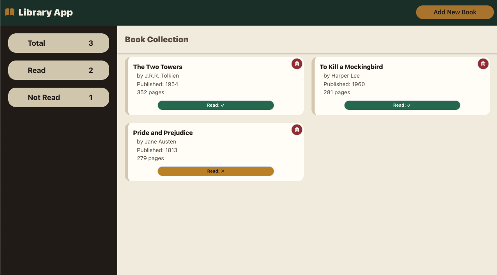

# 📚 Library App

A simple, responsive book library manager built with vanilla HTML, CSS, and JavaScript. Add books, mark them as read or unread, delete them, and keep track of your reading progress at a glance.

🔗 **[Live Demo](https://hawaiianborgir.github.io/library-app/)**



## Features

- **Add new books** through a modal form (title, author, year, pages, read status)
- **Toggle read status** on any book with a single click
- **Delete books** with a confirmation prompt to prevent accidents
- **Live counters** in the sidebar showing total, read, and not-read books
- **Form validation** with native HTML constraints (required fields, 4-digit year, positive page count) and visual feedback for invalid input
- **Responsive card grid** that adapts to the available width
- Newest books appear first in the collection

## Tech Stack

- **HTML5**: semantic markup, native `<dialog>` element with the Invoker Commands API (`command` / `commandfor`)
- **CSS3**: Grid and Flexbox layout, CSS custom properties for theming, a modern CSS reset
- **JavaScript (ES6)**: constructor functions and prototypes, event delegation, `crypto.randomUUID()` for unique book IDs

No frameworks, no dependencies, no build step.

## Getting Started

1. Clone the repository:
   ```bash
   git clone https://github.com/hawaiianborgir/library-app.git
   ```
2. Navigate into the project folder:
   ```bash
   cd library-app
   ```
3. Open `index.html` in your browser. That's it!

> **Note:** The "Add New Book" button and dialog close button rely on the [Invoker Commands API](https://developer.mozilla.org/en-US/docs/Web/API/Invoker_Commands_API) and `closedby`, so use an up-to-date version of Chrome, Edge, Safari, or Firefox.

## Project Structure

```
├── index.html   # Page structure and the add-book dialog
├── style.css    # Styling, theme variables, and layout
├── script.js    # Library logic, DOM rendering, and event handling
└── book.svg     # Favicon / logo icon
```

## How It Works

- Books are stored in the `myLibrary` array as `Book` objects, each with a unique `id`.
- Each rendered card carries a `data-book-id` attribute that links the DOM element back to its book in the array.
- Click handlers for delete and read-toggle are attached once to the container using **event delegation**, so they also work for books added dynamically.
- The `changeReadStatus` method lives on `Book.prototype`, shared across all book instances.

## Possible Future Improvements

- Persist the library with `localStorage`
- Search, sort, and filter books
- Edit existing book details
- Replace the delete `confirm()` with a custom dialog

## Author

Made by [@hawaiianborgir](https://github.com/hawaiianborgir)